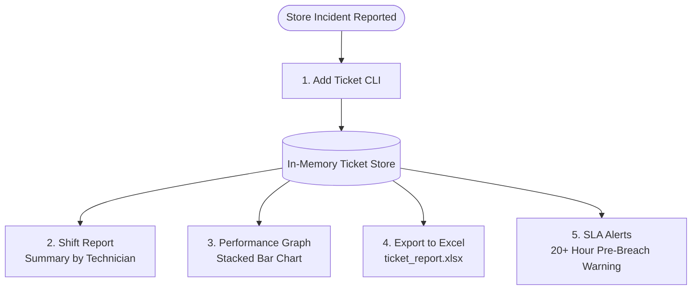

# Smart IT Ticket System (CLI Service Desk & SLA Tracker)

> **Project Started:** 01 March 2026 | **Tech Stack:** Python 3, `datetime`, `matplotlib`, `openpyxl`

## 1. Executive Summary & Project Purpose
I designed and built the **Smart IT Ticket System** to solve a common operational challenge in multi-site IT service desk environments: **tracking incident response times, technician productivity, and SLA compliance in real time.**

This tool provides a lightweight Command-Line Interface (CLI) for logging retail/store technical issues (`Till`, `KDS`, `Network`, `DayEnd`, `Online Ordering`, `MX`), generating instant technician shift summaries, exporting structured Excel reports, and flagging open tickets before they breach a **24-hour SLA**.

---

## 2. Project Evolution
The system was built iteratively across four distinct phases, demonstrating progressive growth in Python software development, data structures, and operational reporting:

| Stage | Feature Focus | Core Technical Skills |
| :--- | :--- | :--- |
| **Phase 1: Basic Counter** | Simple loops to log and count incoming store issues. | Variables, Control Flow, User Input |
| **Phase 2: List Management** | Stored multiple ticket properties dynamically in memory. | Data Structures, Dictionaries & Lists |
| **Phase 3: SLA & Timestamps** | Integrated `datetime` modules to track exact ticket lifespan. | Logic Design, Time Delta Calculations |
| **Phase 4: Analytics & Automation** | Added stacked bar charts and automated Excel reporting. | Data Visualization (`matplotlib`), File I/O (`openpyxl`) |

---

## 3. System Architecture & Capabilities



### Core Functions
* **`add_ticket()`**: Logs technician name, store location, issue category (`KDS`, `DayEnd`, `Online Ordering`, `MX`, `Network`, `Till Issue`), timestamp, and ticket status (`Open`, `OnHold`, `Onsite`, `Closed`).
* **`shift_report()`**: Generates instant counts of active and total worked tickets per technician for shift handovers.
* **`performance_graph()`**: Uses `matplotlib` to render stacked bar charts visualizing technician workload distribution by ticket status (featuring fixed bar widths, custom status colors, and integer Y-axis scaling).
* **`export_excel()`**: Uses `openpyxl` to write ticket records into a structured Excel spreadsheet (`ticket_report.xlsx`) for management reporting.
* **`sla_alert()`**: Scans open incidents and flags tickets exceeding **20 hours** as **Proactive Pre-Breach Alerts** before violating the **24-hour SLA**.

---

## 4. Installation & Execution

### Prerequisites
Ensure Python 3 is installed along with the required reporting libraries:
```bash
pip install matplotlib openpyxl
```

### Run the Application
```bash
git clone https://github.com
cd Smart-IT-Ticketing-System/IT_Ticket_Project
python ticket_system.py
```

---

## 5. System Output Walkthrough

### Step 1: Application Menu & Data Entry
```text
===== SMART IT TICKET SYSTEM =====
1. Add Ticket
2. Shift Report
3. View Performance Graph
4. Export to Excel
5. SLA Alerts
6. Exit
Choose option (1-6): 1
Technician name: Fhumulani
Store name: Store Branch 01
Type (KDS / DayEnd / Online Ordering / MX / Network / Till Issue): Till Issue
Status (Closed / OnHold / Onsite / Open / In Progress): Open
[INFO] Ticket logged successfully.
```

### Step 2: Automated Shift Summary & Excel Export
* **Option 2 (`Shift Report`):** Displays live open vs. total worked tickets per technician.
* **Option 4 (`Export to Excel`):** Generates `ticket_report.xlsx` with structured columns (`Technician`, `Store`, `Type`, `Status`, `Shift Date`, `Time Logged`).

```text
===== TECHNICIAN SHIFT REPORT =====

Technician: Fhumulani | Date: 2026-07-27
  Open: 1
Total Worked: 1
[INFO] Excel report exported successfully as 'ticket_report.xlsx'
```

### Step 3: Visual Performance Analytics
* **Option 3 (`View Performance Graph`):** Generates an interactive `matplotlib` stacked bar chart visualizing technician workload distribution across `Closed`, `Onsite`, and `OnHold / Open / In Progress` tickets.

---

## 6. Conclusion
The **Smart IT Ticket System** demonstrates how Python automation streamlines manual service desk workflows. By combining script-driven SLA tracking with automated Excel exports and visual analytics, the tool reduces manual reporting errors and gives IT support leads real-time visibility into ticket resolution and SLA compliance.
